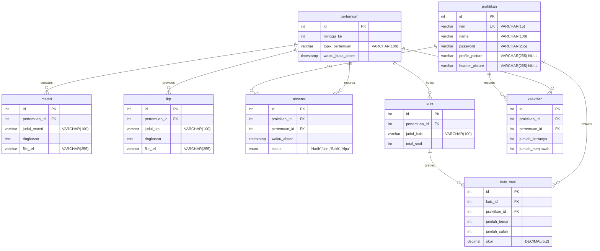

# Entity Relationship Diagram (ERD) — Dashboard Praktikum Basis Data

Dokumentasi model data relasional sesuai spesifikasi ERD sistem praktikum.

## Diagram ERD Utama

## Deskripsi Entitas & Atribut

1. **praktikan**:
   - `id`: Primary key entitas praktikan.
   - `nim`: Nomor Induk Mahasiswa (Unique constraint).
   - `nama`: Nama lengkap praktikan dari CSV.
   - `password`: Kredensial autentikasi.
   - `profile_picture`: Avatar profil custom praktikan (nullable).
   - `header_picture`: Custom banner/tema header profil (nullable).

2. **pertemuan**:
   - `id`: Primary key sesi pertemuan praktikum.
   - `minggu_ke`: Nomor urut minggu (1 s.d. 14).
   - `topik_pertemuan`: Topik silabus pertemuan dari CSV.
   - `waktu_buka_akses`: Jadwal timestamp pembukaan akses materi/LKP.

3. **materi**:
   - `id`: Primary key materi.
   - `pertemuan_id`: Foreign key ke `pertemuan.id`.
   - `judul_materi`: Judul materi dari CSV.
   - `ringkasan`: Deskripsi ringkasan tujuan materi.
   - `file_url`: URL dokumen materi (default NULL sampai diisi oleh Asprak).

4. **lkp**:
   - `id`: Primary key Lembar Kerja Praktikum.
   - `pertemuan_id`: Foreign key ke `pertemuan.id`.
   - `judul_lkp`: Judul lembar kerja.
   - `ringkasan`: Instruksi pengerjaan LKP.
   - `file_url`: URL file LKP (default NULL sampai diisi oleh Asprak).

5. **absensi**:
   - `id`: Primary key pencatatan absensi.
   - `praktikan_id`: Foreign key ke `praktikan.id`.
   - `pertemuan_id`: Foreign key ke `pertemuan.id`.
   - `waktu_absen`: Timestamp waktu presensi.
   - `status`: ENUM status kehadiran ('Hadir', 'Izin', 'Sakit', 'Alpa').
   - Catatan: Setiap mahasiswa diinisialisasi 5 kehadiran awal ('Hadir' pada pertemuan 1 s.d. 5).

6. **kuis** & **kuis_hasil**:
   - Evaluasi kuis per pertemuan dan rekap skor, jumlah benar/salah setiap praktikan.

7. **keaktifan**:
   - Penghitungan jumlah bertanya dan menjawab saat sesi praktikum.
