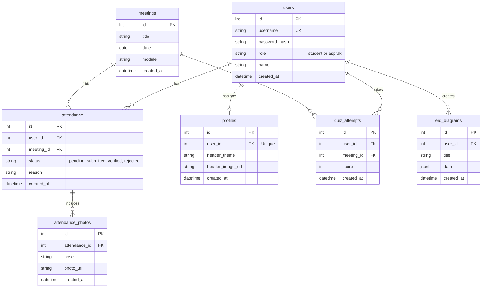

# Entity Relationship Diagram

This project uses PostgreSQL for data persistence. Below is the ERD diagram for the application.

## Description
- **users**: Stores authentication and user role data. Both students and aspraks are stored here.
- **meetings**: Stores information about the practicum modules and sessions.
- **attendance**: Links a user to a meeting to record their attendance status.
- **attendance_photos**: Stores the multi-pose photos taken during the photobooth attendance flow.
- **profiles**: Stores customization data for the user's dashboard header.
- **quiz_attempts**: Records scores for quizzes taken by users. (Used for calculating leaderboard standings without needing a dedicated leaderboard table).
- **erd_diagrams**: Stores JSON representations of the ERD designs created in the interactive diagram builder.
